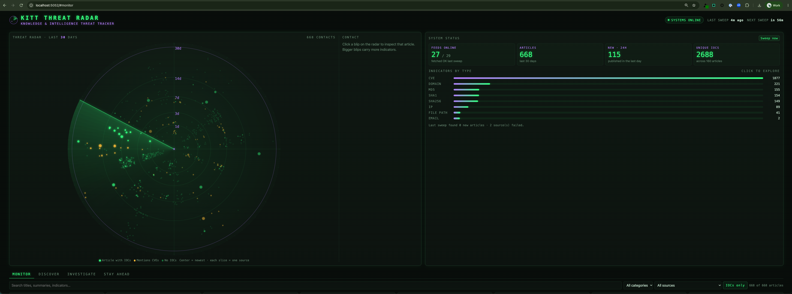
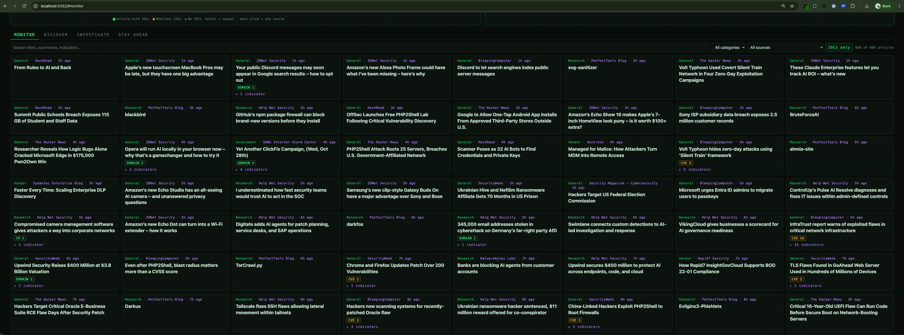
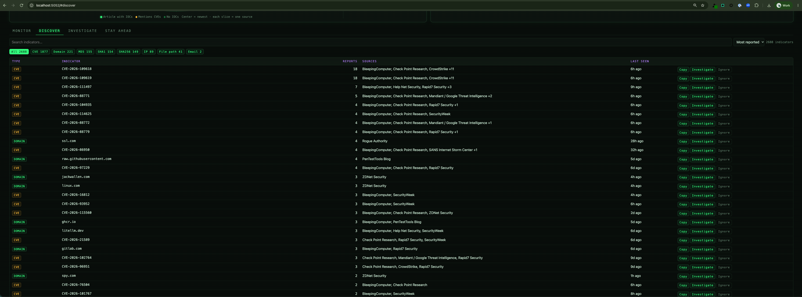
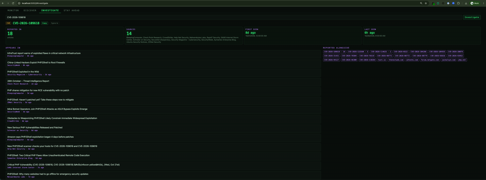
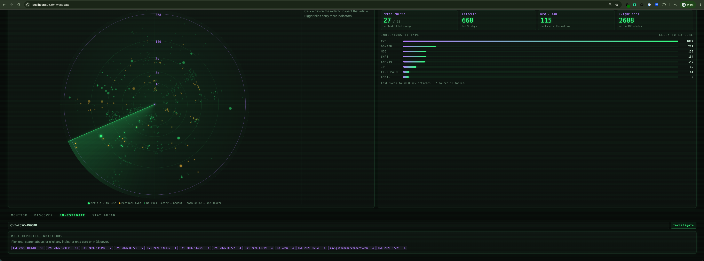

# 📡 KITT Threat Radar

**Knowledge & Intelligence Threat Tracker**

KITT is a self-hosted threat intelligence console. It sweeps 29 security RSS feeds (vendor research, news and government advisories) every hour, extracts the IOCs from each article, and puts it all on a live radar with tools to search, investigate and export what it finds.

Built for SOC analysts, threat hunters and blue teamers who want one place to watch the threat landscape without paying for a platform.



## 🧠 What it does

- **Live threat radar.** Every article from the last 30 days is a blip. Newest sits at the center, each source has its own slice, bigger blips carry more indicators, and amber marks articles that mention CVEs. Hover to preview, click to inspect.
- **System status at a glance.** Feeds online, articles collected, new in the last 24 hours, unique IOCs, and a breakdown by indicator type. The header shows when the last sweep ran and when the next one is due.
- **IOC extraction.** Pulls IPs, domains, emails, MD5/SHA1/SHA256 hashes, CVEs and Windows file paths from the article body, and drops the noise: the publisher's own site, filenames that look like domains, private IPs and anything on your ignore list.
- **Hands-off updates.** Sweeps every hour (or on demand), saves as each source finishes, and the dashboard refreshes itself when new intel lands.
- **Fresh by default.** Newest first; anything older than 30 days is pruned (set `MAX_AGE_DAYS` in `docker-compose.yml` to change it).
- **Runs in Docker.** One command to start, comes back on its own after a reboot, and scales from a laptop screen to an ultrawide monitor.

## 🛰 Four workspaces

### Monitor
The live feed. Search titles, summaries and indicators; filter by category, source or articles with IOCs. Each card expands to show its indicators, and clicking one jumps to Investigate.



### Discover
Every unique indicator in one table, filterable by type and searchable, sorted by how many articles reported it. Copy, investigate or ignore any row.



### Investigate
Pick an indicator to see every article it appeared in, which sources reported it, when it was first and last seen, and which other indicators were reported alongside it. With nothing selected, it suggests the most-reported indicators.





### Stay Ahead
Export to CSV or STIX 2.1, run a sweep on demand, check per-feed health (with error messages for failing sources), review sweep history and manage the ignore list.

## 🚀 Quick start (Docker, recommended)

Requires [Docker Desktop](https://www.docker.com/products/docker-desktop/) or another Docker engine with Compose.

```bash
git clone https://github.com/dustinfant/KITT-Threat-Radar.git
cd KITT-Threat-Radar
docker compose up -d --build
```

Open **http://localhost:5052**. On a fresh install the first sweep takes 10–20 minutes; articles appear as each source finishes, and the page updates on its own.

The container is set to `restart: unless-stopped`, so it comes back whenever Docker starts. Turn on *Start Docker Desktop when you sign in* in Docker Desktop's settings and the dashboard is up every time you log in.

| Task | Command |
|---|---|
| Watch the logs | `docker compose logs -f` |
| Restart (after editing `sources.yaml`) | `docker compose restart` |
| Sweep now | the **Sweep now** button, or `curl -X POST localhost:5052/api/refresh` |
| Rebuild (after changing code or templates) | `docker compose up -d --build` |
| Stop | `docker compose down` |

`data/`, `sources.yaml` and `ioc_ignore.yaml` are mounted from the host, so the collected feed survives rebuilds and config changes don't need one.

## 🐍 Running without Docker

Requires Python 3.10+.

```bash
python3 -m venv venv
source venv/bin/activate
pip install -r requirements.txt
python app.py
```

Then open http://localhost:5052. `app.py` fetches on startup and every hour after. `restart_flask.sh` restarts it in the background and logs to `flask.log`.

To populate the feed without starting the server:

```bash
python fetcher/fetch_normalized.py
```

## 🗂 Adding sources

Edit `sources.yaml`. Each entry needs a name, an RSS/Atom URL and a category:

```yaml
- name: Some Source
  url: https://example.com/feed.xml
  category: Vendor   # Vendor | Research | General | Government
```

With Docker, run `docker compose restart` to pick up the change.

Currently configured: 9 vendor feeds (Mandiant, CrowdStrike, SentinelOne, Huntress, Check Point Research, Microsoft and more), 11 research and community blogs (Squiblydoo, Securelist, Malwarebytes Labs, AdSecurity and more), 7 news outlets (BleepingComputer, The Hacker News, SecurityWeek, Schneier on Security and more) and 2 government sources (CISA, SANS ISC).

## 🚫 Ignoring noisy indicators

`ioc_ignore.yaml` hides indicators everywhere, exports included:

- **domains:** reference sites, social media and security vendors (each entry covers its subdomains).
- **values:** exact IPs, hashes, emails, CVEs or paths. The **Ignore** buttons in Discover and Investigate add to this list, and Stay Ahead lists it with one-click undo.

Private, loopback and reserved IPs are always ignored. Edits apply within a minute without a restart, and un-ignoring brings an indicator back, since stored data is never stripped.

## 📊 API

| Path | Returns |
|---|---|
| `/` | The console |
| `/api/feed` | Recent articles (newest first) with their IOCs |
| `/api/feed/count` | `{"count", "latest"}`, polled by the dashboard to spot new articles |
| `/api/iocs` | One row per unique indicator: type, value, report count, sources, first/last seen |
| `/api/stats` | Feed, article and IOC counts |
| `/api/status` | Sweep state, next sweep time, per-feed health and sweep history |
| `/api/ignore` | `GET` the ignore list; `POST` / `DELETE` `{"value": "..."}` to add or remove |
| `POST /api/refresh` | Starts a sweep now |
| `/export/csv` | Articles with IOCs, one row per article |
| `/export/stix` | A STIX 2.1 bundle of indicators |

## 📦 Project structure

```
KITT-Threat-Radar/
├── app.py                 # Flask app, API, hourly sweeps, feed health, exports
├── ioc_utils.py           # IOC extraction, cleanup and ignore list
├── sources.yaml           # RSS sources and categories
├── ioc_ignore.yaml        # Indicators to hide
├── templates/index.html   # The console: radar, stats and four workspaces
├── fetcher/               # Standalone fetch scripts
├── data/                  # feed + sweep status (local only, not in git)
├── docs/screenshots/      # README images
├── Dockerfile
├── docker-compose.yml
├── requirements.txt
└── restart_flask.sh       # Non-Docker restart helper
```

## 📝 Notes

- IOC extraction is regex-based. It reads only the article body, drops the publisher's own domains, filenames that look like domains (`httpd.conf`, `update.zip`) and invalid IPs, but expect some noise, such as reference sites the article cites.
- Flask's built-in server is fine for local use. The dashboard can start sweeps and edit the ignore list, so add authentication and a production WSGI server before exposing it beyond your machine.
