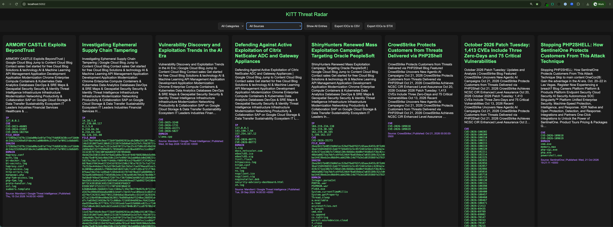

# 📡 KITT Threat Radar

KITT is a self-hosted threat intelligence dashboard. It pulls security research blogs, vendor advisories and government alerts from 29 RSS feeds, extracts the IOCs from each article, and lets you filter them and export them to CSV or STIX 2.1.

Built for SOC analysts, threat hunters and blue teamers who want one place to watch the intel landscape without paying for a platform.



## 🧠 Features

- **One feed, many sources.** Aggregates vendor, research, news and government RSS feeds configured in `sources.yaml`.
- **IOC extraction.** Pulls IPs, domains, emails, MD5/SHA1/SHA256 hashes and CVEs out of every article.
- **Filtering.** Narrow by category, source, or only articles that contain IOCs.
- **Export.** Download IOCs as CSV or as a STIX 2.1 bundle for SIEM/EDR ingestion.
- **Fresh by default.** Newest articles first; anything older than 30 days is hidden and pruned (set `MAX_AGE_DAYS` in `docker-compose.yml` to change it).
- **Hands-off updates.** The server refetches every hour, and the dashboard reloads itself when new articles land, keeping your filters and scroll position.
- **Runs in Docker.** One command to start, restarts on its own after a reboot.

## 🚀 Quick start (Docker, recommended)

Requires [Docker Desktop](https://www.docker.com/products/docker-desktop/) or another Docker engine with Compose.

```bash
git clone https://github.com/dustinfant/KITT-Threat-Radar.git
cd KITT-Threat-Radar
docker compose up -d --build
```

Open **http://localhost:5052**. On a fresh install the page shows "Fetching feeds..." for a few minutes while the first pull runs, then reloads on its own.

The container is set to `restart: unless-stopped`, so it comes back whenever Docker starts. Turn on *Start Docker Desktop when you sign in* in Docker Desktop's settings and the dashboard is up every time you log in.

| Task | Command |
|---|---|
| Watch the logs | `docker compose logs -f` |
| Restart (after editing `sources.yaml`) | `docker compose restart` |
| Rebuild (after changing code or templates) | `docker compose up -d --build` |
| Stop | `docker compose down` |

`data/` and `sources.yaml` are mounted from the host, so the collected feed survives rebuilds and source changes don't need one.

## 🐍 Running without Docker

Requires Python 3.10+.

```bash
python3 -m venv venv
source venv/bin/activate
pip install -r requirements.txt
python app.py
```

Then open http://localhost:5052. `app.py` fetches on startup and every hour after. `restart_flask.sh` restarts it in the background and logs to `flask.log`.

To populate the feed without starting the server:

```bash
python fetcher/fetch_normalized.py
```

## 🗂 Adding sources

Edit `sources.yaml`. Each entry needs a name, an RSS/Atom URL and a category:

```yaml
- name: Some Source
  url: https://example.com/feed.xml
  category: Vendor   # Vendor | Research | General | Government
```

With Docker, run `docker compose restart` to pick up the change.

Currently configured: 9 vendor feeds (Mandiant, CrowdStrike, SentinelOne, Huntress, Check Point Research, Microsoft and more), 11 research and community blogs (Squiblydoo, Securelist, Malwarebytes Labs, AdSecurity and more), 7 news outlets (BleepingComputer, The Hacker News, SecurityWeek, Schneier on Security and more) and 2 government sources (CISA, SANS ISC).

## 📊 Endpoints

| Path | Returns |
|---|---|
| `/` | The dashboard |
| `/api/feed` | The full normalized feed as JSON |
| `/api/feed/count` | `{"count": n}`, which the dashboard polls for new articles |
| `/export/csv` | Articles with IOCs, one row per article |
| `/export/stix` | A STIX 2.1 bundle of indicators |

## ⚙️ GitHub Action

`.github/workflows/fetch_feed.yml` runs the fetcher hourly on GitHub and commits the refreshed `data/feed_normalized.json`, so the repo always carries a recent snapshot of the feed. It can also be run by hand from the Actions tab.

## 📦 Project structure

```
KITT-Threat-Radar/
├── app.py                 # Flask app, IOC extraction, hourly scheduler, exports
├── sources.yaml           # RSS sources and categories
├── templates/index.html   # Dashboard UI
├── fetcher/               # Standalone fetch scripts (used by the GitHub Action)
├── data/                  # feed_normalized.json lives here
├── Dockerfile
├── docker-compose.yml
├── requirements.txt
└── restart_flask.sh       # Non-Docker restart helper
```

## 📝 Notes

- IOC extraction is regex-based. It reads only the article body, drops the publisher's own domains, filenames that look like domains (`httpd.conf`, `update.zip`) and invalid IPs, but expect some noise, such as reference sites the article cites.
- Flask's built-in server is fine for local use. Put it behind a production WSGI server before exposing it beyond your machine.
